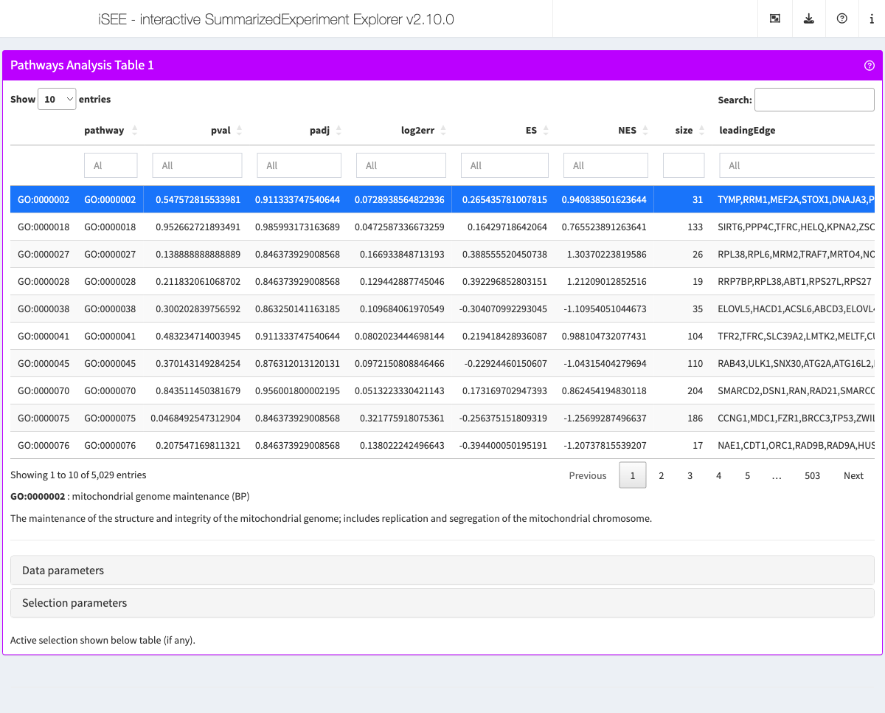

# Working with the Gene Ontology

## Scenario

In this vignette, we demonstrate how one may use the package
*[GO.db](https://bioconductor.org/packages/3.24/GO.db)* to dynamically
display additional information about selected pathways in the
interactive user interface.

## Demonstration

### Example data

First, we generate pathway analysis results for simulated data using
*[fgsea](https://bioconductor.org/packages/3.24/fgsea)*.

In particular, we use the package
*[org.Hs.eg.db](https://bioconductor.org/packages/3.24/org.Hs.eg.db)* to
fetch real gene sets. To reduce memory footprint, we retain only the
gene sets associated with 15 to 500 genes.

Then, we simulate a score for each of the gene present in any of those
remaining gene sets. In practice, that score could be the log₂
fold-change of the gene in a differential expression analysis (among
other possibilities).

Finally, we perform an FGSEA on the simulated data.

\
[`library`](https://rdrr.io/r/base/library.html)`(``"org.Hs.eg.db"``)`\
[`library`](https://rdrr.io/r/base/library.html)`(`[`"fgsea"`](https://github.com/alserglab/fgsea/)`)`\
\
`# Example data ----`\
\
`## Pathways`\
`pathways`` ``<-`` `[`select`](https://rdrr.io/pkg/AnnotationDbi/man/AnnotationDb-class.html)`(``org.Hs.eg.db``, `[`keys`](https://rdrr.io/pkg/AnnotationDbi/man/AnnotationDb-class.html)`(``org.Hs.eg.db``, ``"SYMBOL"``)``, `[`c`](https://rdrr.io/r/base/c.html)`(``"GOALL"``)``, keytype ``=`` ``"SYMBOL"``)`\
`pathways`` ``<-`` `[`subset`](https://rdrr.io/r/base/subset.html)`(``pathways``, ``ONTOLOGYALL`` ``==`` ``"BP"``)`\
`pathways`` ``<-`` `[`unique`](https://rdrr.io/r/base/unique.html)`(``pathways``[``, `[`c`](https://rdrr.io/r/base/c.html)`(``"SYMBOL"``, ``"GOALL"``)``]``)`\
`pathways`` ``<-`` `[`split`](https://rdrr.io/r/base/split.html)`(``pathways``$``SYMBOL``, ``pathways``$``GOALL``)`\
`len_pathways`` ``<-`` `[`lengths`](https://rdrr.io/r/base/lengths.html)`(``pathways``)`\
`pathways`` ``<-`` ``pathways``[``len_pathways`` ``>`` ``15`` ``&`` ``len_pathways`` ``<`` ``500``]`\
\
`## Features`\
[`set.seed`](https://rdrr.io/r/base/Random.html)`(``1``)`\
`# simulate a score for all genes found across all pathways`\
`feature_stats`` ``<-`` `[`rnorm`](https://rdrr.io/r/stats/Normal.html)`(`[`length`](https://rdrr.io/r/base/length.html)`(`[`unique`](https://rdrr.io/r/base/unique.html)`(`[`unlist`](https://rdrr.io/r/base/unlist.html)`(``pathways``)``)``)``)`\
[`names`](https://rdrr.io/r/base/names.html)`(``feature_stats``)`` ``<-`` `[`unique`](https://rdrr.io/r/base/unique.html)`(`[`unlist`](https://rdrr.io/r/base/unlist.html)`(``pathways``)``)`\
`# arbitrarily select a pathway to simulate enrichment`\
`pathway_id`` ``<-`` ``"GO:0046324"`\
`pathway_genes`` ``<-`` ``pathways``[[``pathway_id``]``]`\
`# increase score of genes in the selected pathway to simulate enrichment`\
`feature_stats``[``pathway_genes``]`` ``<-`` ``feature_stats``[``pathway_genes``]`` ``+`` ``1`\
\
`# fgsea ----`\
\
[`set.seed`](https://rdrr.io/r/base/Random.html)`(``42``)`\
`fgseaRes`` ``<-`` `[`fgsea`](https://rdrr.io/pkg/fgsea/man/fgsea.html)`(``pathways ``=`` ``pathways``, `\
`                  stats    ``=`` ``feature_stats``,`\
`                  minSize  ``=`` ``15``,`\
`                  maxSize  ``=`` ``500``)`\
[`head`](https://rdrr.io/r/utils/head.html)`(``fgseaRes``[`[`order`](https://rdrr.io/r/base/order.html)`(``pval``)``, ``]``)`\
`#>       pathway         pval         padj   log2err        ES      NES  size`\
`#>        <char>        <num>        <num>     <num>     <num>    <num> <int>`\
`#> 1: GO:0046324 1.708589e-08 7.734784e-05 0.7337620 0.6229286 2.469155    50`\
`#> 2: GO:0010827 3.663626e-08 8.292617e-05 0.7195128 0.5573615 2.354422    65`\
`#> 3: GO:0046326 6.821721e-07 1.009323e-03 0.6594444 0.6680772 2.377560    31`\
`#> 4: GO:0010828 8.918254e-07 1.009323e-03 0.6594444 0.6283217 2.357508    39`\
`#> 5: GO:0098704 6.834062e-06 4.419685e-03 0.6105269 0.4911191 2.124972    72`\
`#> 6: GO:0098708 6.834062e-06 4.419685e-03 0.6105269 0.4911191 2.124972    72`\
`#>                                  leadingEdge`\
`#>                                       <list>`\
`#> 1:   IRS1,LEP,PTH,CERS1,CAPN10,ITLN1,...[34]`\
`#> 2:   IRS1,LEP,PTH,CERS1,CAPN10,ITLN1,...[37]`\
`#> 3: IRS1,PTH,CAPN10,ITLN1,PRKCI,FGF21,...[23]`\
`#> 4: IRS1,PTH,CAPN10,ITLN1,PRKCI,FGF21,...[24]`\
`#> 5:   IRS1,LEP,PTH,CERS1,CAPN10,ITLN1,...[39]`\
`#> 6:   IRS1,LEP,PTH,CERS1,CAPN10,ITLN1,...[39]`

Then, we embed the
*[fgsea](https://bioconductor.org/packages/3.24/fgsea)* results in a
*[SummarizedExperiment](https://bioconductor.org/packages/3.24/SummarizedExperiment)*
object.

In this case, we create an empty `?SummarizedExperiment-class` object,
without any simulated count data nor metadata, as we will not be using
any of those data in this example.

We then embed the pathway analysis results in the newly created
`?SummarizedExperiment-class` object.

But first, we reorder the results by increasing p-value. Although not
essential, this implicitly defines the default ordering of the table in
the live app.

\
[`library`](https://rdrr.io/r/base/library.html)`(`[`"SummarizedExperiment"`](https://bioconductor.org/packages/SummarizedExperiment)`)`\
[`library`](https://rdrr.io/r/base/library.html)`(`[`"iSEEpathways"`](https://github.com/iSEE/iSEEpathways)`)`\
`se`` ``<-`` `[`SummarizedExperiment`](https://rdrr.io/pkg/SummarizedExperiment/man/SummarizedExperiment-class.html)`(``)`\
`fgseaRes`` ``<-`` ``fgseaRes``[`[`order`](https://rdrr.io/r/base/order.html)`(``pval``)``, ``]`\
`se`` ``<-`` `[`embedPathwaysResults`](https://isee.github.io/iSEEpathways/reference/utils-SummarizedExperiment.md)`(``fgseaRes``, ``se``, name ``=`` ``"fgsea"``, class ``=`` ``"fgsea"``, pathwayType ``=`` ``"GO"``)`

### Pathway information

In this example, we configure the app option
`PathwaysTable.select.details` to define a function that, given the
identifier of the GO term currently selected in a panel, displays
information about that GO term.

Although not essential, this is a user-friendly and immediate way to
‘translate’ machine-friendly database identifiers into human-friendly
descriptions.

\
[`library`](https://rdrr.io/r/base/library.html)`(`[`"iSEE"`](https://isee.github.io/iSEE/)`)`\
[`library`](https://rdrr.io/r/base/library.html)`(``"GO.db"``)`\
[`library`](https://rdrr.io/r/base/library.html)`(`[`"shiny"`](https://shiny.posit.co/)`)`\
`go_details`` ``<-`` ``function``(``x``)`` ``{`\
`    ``info`` ``<-`` `[`select`](https://rdrr.io/pkg/AnnotationDbi/man/AnnotationDb-class.html)`(``GO.db``, ``x``, `[`c`](https://rdrr.io/r/base/c.html)`(``"TERM"``, ``"ONTOLOGY"``, ``"DEFINITION"``)``, ``"GOID"``)`\
`    ``html`` ``<-`` `[`list`](https://rdrr.io/r/base/list.html)`(`[`p`](https://rstudio.github.io/htmltools/reference/builder.html)`(`[`strong`](https://rstudio.github.io/htmltools/reference/builder.html)`(``info``$``GOID``)``, ``":"``, ``info``$``TERM``, `[`paste0`](https://rdrr.io/r/base/paste.html)`(``"("``, ``info``$``ONTOLOGY``, ``")"``)``)``)`\
`    ``if`` ``(``!`[`is.na`](https://rdrr.io/r/base/NA.html)`(``info``$``DEFINITION``)``)`` ``{`\
`        ``html`` ``<-`` `[`append`](https://rdrr.io/r/base/append.html)`(``html``, `[`list`](https://rdrr.io/r/base/list.html)`(`[`p`](https://rstudio.github.io/htmltools/reference/builder.html)`(``info``$``DEFINITION``)``)``)`\
`    ``}`\
`    `[`tagList`](https://rstudio.github.io/htmltools/reference/tagList.html)`(``html``)`\
`}`\
`se`` ``<-`` `[`registerAppOptions`](https://isee.github.io/iSEE/reference/registerAppOptions.html)`(``se``, PathwaysTable.select.details ``=`` ``go_details``)`

### Live app

Finally, we configure the app initial state and launch the live app.

\
`app`` ``<-`` `[`iSEE`](https://isee.github.io/iSEE/reference/iSEE.html)`(``se``, initial ``=`` `[`list`](https://rdrr.io/r/base/list.html)`(`\
`  `[`PathwaysTable`](https://isee.github.io/iSEEpathways/reference/PathwaysTable-class.md)`(``ResultName``=``"fgsea"``, Selected ``=`` ``"GO:0046324"``, PanelWidth ``=`` ``12L``)`\
`)``)`\
\
`if`` ``(`[`interactive`](https://rdrr.io/r/base/interactive.html)`(``)``)`` ``{`\
`  ``shiny``::`[`runApp`](https://rdrr.io/pkg/shiny/man/runApp.html)`(``app``)`\
`}`

## Reproducibility

The
*[iSEEpathways](https://bioconductor.org/packages/3.24/iSEEpathways)*
package (Rue-Albrecht and Soneson, 2024) was made possible thanks to:

- R (R Core Team, 2026)
- *[BiocStyle](https://bioconductor.org/packages/3.24/BiocStyle)* (Oleś,
  2026)
- *[knitr](https://CRAN.R-project.org/package=knitr)* (Xie, 2026)
- *[RefManageR](https://CRAN.R-project.org/package=RefManageR)* (McLean,
  2017)
- *[rmarkdown](https://CRAN.R-project.org/package=rmarkdown)* (Allaire,
  Xie, Dervieux, McPherson, Luraschi, Ushey, Atkins, Wickham, Cheng,
  Chang, and Iannone, 2026)
- *[sessioninfo](https://CRAN.R-project.org/package=sessioninfo)*
  (Wickham, Chang, Flight, Müller, and Hester, 2026)
- *[testthat](https://CRAN.R-project.org/package=testthat)* (Wickham,
  2011)

This package was developed using
*[biocthis](https://bioconductor.org/packages/3.24/biocthis)*.

Code for creating the vignette

\
`## Create the vignette`\
[`library`](https://rdrr.io/r/base/library.html)`(`[`"rmarkdown"`](https://github.com/rstudio/rmarkdown)`)`\
[`system.time`](https://rdrr.io/r/base/system.time.html)`(`[`render`](https://pkgs.rstudio.com/rmarkdown/reference/render.html)`(``"gene-ontology.Rmd"``, ``"BiocStyle::html_document"``)``)`\
\
`## Extract the R code`\
[`library`](https://rdrr.io/r/base/library.html)`(`[`"knitr"`](https://yihui.org/knitr/)`)`\
[`knit`](https://rdrr.io/pkg/knitr/man/knit.html)`(``"gene-ontology.Rmd"``, tangle ``=`` ``TRUE``)`

Date the vignette was generated.

    #> [1] "2026-10-22 14:13:33 UTC"

Wallclock time spent generating the vignette.

    #> Time difference of 37.396 secs

`R` session information.

    #> ─ Session info ───────────────────────────────────────────────────────────────────────────────────────────────────────
    #>  setting  value
    #>  version  R version 4.6.1 (2026-06-24)
    #>  os       Ubuntu 24.04.5 LTS
    #>  system   x86_64, linux-gnu
    #>  ui       X11
    #>  language en
    #>  collate  en_US.UTF-8
    #>  ctype    en_US.UTF-8
    #>  tz       UTC
    #>  date     2026-10-22
    #>  pandoc   3.12.1 @ /usr/bin/ (via rmarkdown)
    #>  quarto   1.10.18 @ /usr/local/bin/quarto
    #> 
    #> ─ Packages ───────────────────────────────────────────────────────────────────────────────────────────────────────────
    #>  package              * version  date (UTC) lib source
    #>  abind                  1.4-8    2024-09-12 [1] RSPM (R 4.6.0)
    #>  AnnotationDbi        * 1.75.2   2026-07-21 [1] Bioconductor 3.24 (R 4.6.1)
    #>  bibtex                 0.5.3    2026-09-22 [1] RSPM (R 4.6.0)
    #>  Biobase              * 2.73.2   2026-07-29 [1] Bioconductor 3.24 (R 4.6.1)
    #>  BiocBaseUtils          1.15.1   2026-05-10 [1] Bioconductor 3.24 (R 4.6.1)
    #>  BiocGenerics         * 0.59.12  2026-08-11 [1] Bioconductor 3.24 (R 4.6.1)
    #>  BiocManager            1.30.27  2025-11-14 [2] CRAN (R 4.6.1)
    #>  BiocParallel           1.47.0   2026-04-28 [1] Bioconductor 3.24 (R 4.6.1)
    #>  BiocStyle            * 2.41.0   2026-04-28 [1] Bioconductor 3.24 (R 4.6.1)
    #>  Biostrings             2.81.9   2026-09-06 [1] Bioconductor 3.24 (R 4.6.1)
    #>  bit                    4.6.0    2025-03-06 [1] RSPM (R 4.6.0)
    #>  bit64                  4.8.6    2026-09-01 [1] RSPM (R 4.6.0)
    #>  blob                   1.3.0    2026-01-14 [1] RSPM (R 4.6.0)
    #>  bookdown               0.48     2026-08-28 [1] RSPM (R 4.6.0)
    #>  bslib                  0.12.0   2026-08-04 [2] RSPM (R 4.6.0)
    #>  cachem                 1.1.0    2024-05-16 [2] RSPM (R 4.6.0)
    #>  circlize               0.4.18   2026-04-04 [1] RSPM (R 4.6.0)
    #>  cli                    3.6.6    2026-04-09 [2] RSPM (R 4.6.0)
    #>  clue                   0.3-68   2026-03-26 [1] RSPM (R 4.6.0)
    #>  cluster                2.1.8.3  2026-07-30 [2] RSPM (R 4.6.0)
    #>  codetools              0.2-20   2024-03-31 [3] CRAN (R 4.6.1)
    #>  colorspace             2.1-4    2026-10-08 [1] RSPM (R 4.6.0)
    #>  colourpicker           1.3.0    2023-08-21 [1] RSPM (R 4.6.0)
    #>  ComplexHeatmap         2.29.0   2026-04-28 [1] Bioconductor 3.24 (R 4.6.1)
    #>  cowplot                1.2.0    2025-07-07 [1] RSPM (R 4.6.0)
    #>  crayon                 1.5.3    2024-06-20 [2] RSPM (R 4.6.0)
    #>  data.table             1.18.6.1 2026-08-24 [1] RSPM (R 4.6.0)
    #>  DBI                    1.3.0    2026-02-25 [1] RSPM (R 4.6.0)
    #>  DelayedArray           0.39.8   2026-09-30 [1] Bioconductor 3.24 (R 4.6.1)
    #>  desc                   1.4.3    2023-12-10 [2] RSPM (R 4.6.0)
    #>  digest                 0.6.39   2025-11-19 [2] RSPM (R 4.6.0)
    #>  doParallel             1.0.17   2022-02-07 [1] RSPM (R 4.6.0)
    #>  dplyr                  1.2.1    2026-04-03 [1] RSPM (R 4.6.0)
    #>  DT                     0.34.0   2025-09-02 [1] RSPM (R 4.6.0)
    #>  evaluate               1.0.5    2025-08-27 [2] RSPM (R 4.6.0)
    #>  farver                 2.1.2    2024-05-13 [1] RSPM (R 4.6.0)
    #>  fastmap                1.2.0    2024-05-15 [2] RSPM (R 4.6.0)
    #>  fastmatch              1.1-8    2026-01-17 [1] RSPM (R 4.6.0)
    #>  fgsea                * 1.39.2   2026-06-26 [1] Bioconductor 3.24 (R 4.6.1)
    #>  fontawesome            0.5.3    2024-11-16 [2] RSPM (R 4.6.0)
    #>  foreach                1.5.2    2022-02-02 [1] RSPM (R 4.6.0)
    #>  fs                     2.1.0    2026-04-18 [2] RSPM (R 4.6.0)
    #>  generics             * 0.1.4    2025-05-09 [1] RSPM (R 4.6.0)
    #>  GenomicRanges        * 1.65.4   2026-09-02 [1] Bioconductor 3.24 (R 4.6.1)
    #>  GetoptLong             1.1.1    2026-04-08 [1] RSPM (R 4.6.0)
    #>  ggplot2                4.0.3    2026-04-22 [1] RSPM (R 4.6.0)
    #>  ggrepel                0.9.8    2026-03-17 [1] RSPM (R 4.6.0)
    #>  GlobalOptions          0.1.4    2026-04-08 [1] RSPM (R 4.6.0)
    #>  glue                   1.8.1    2026-04-17 [2] RSPM (R 4.6.0)
    #>  GO.db                * 3.23.1   2026-07-20 [1] Bioconductor
    #>  gtable                 0.3.6    2024-10-25 [1] RSPM (R 4.6.0)
    #>  htmltools              0.5.9    2025-12-04 [2] RSPM (R 4.6.0)
    #>  htmlwidgets            1.6.4    2023-12-06 [2] RSPM (R 4.6.0)
    #>  httpuv                 1.6.17   2026-03-18 [2] RSPM (R 4.6.0)
    #>  httr                   1.4.9    2026-09-01 [1] RSPM (R 4.6.0)
    #>  igraph                 2.3.4    2026-09-30 [1] RSPM (R 4.6.0)
    #>  IRanges              * 2.47.5   2026-08-27 [1] Bioconductor 3.24 (R 4.6.1)
    #>  iSEE                 * 2.25.1   2026-07-13 [1] Bioconductor 3.24 (R 4.6.1)
    #>  iSEEpathways         * 1.11.0   2026-10-22 [1] Bioconductor
    #>  iterators              1.0.14   2022-02-05 [1] RSPM (R 4.6.0)
    #>  jquerylib              0.1.4    2021-04-26 [2] RSPM (R 4.6.0)
    #>  jsonlite               2.0.0    2025-03-27 [2] RSPM (R 4.6.0)
    #>  KEGGREST               1.53.6   2026-07-23 [1] Bioconductor 3.24 (R 4.6.1)
    #>  knitr                  1.52     2026-09-06 [2] RSPM (R 4.6.0)
    #>  later                  1.4.8    2026-03-05 [2] RSPM (R 4.6.0)
    #>  lattice                0.23-1   2026-08-12 [2] RSPM (R 4.6.0)
    #>  lifecycle              1.0.5    2026-01-08 [2] RSPM (R 4.6.0)
    #>  listviewer             4.0.0    2023-09-30 [1] RSPM (R 4.6.0)
    #>  lubridate              1.9.5    2026-02-04 [1] RSPM (R 4.6.0)
    #>  magrittr               2.0.5    2026-04-04 [2] RSPM (R 4.6.0)
    #>  Matrix                 1.7-6    2026-07-25 [2] RSPM (R 4.6.0)
    #>  MatrixGenerics       * 1.25.0   2026-04-28 [1] Bioconductor 3.24 (R 4.6.1)
    #>  matrixStats          * 1.5.0    2025-01-07 [1] RSPM (R 4.6.0)
    #>  memoise                2.0.1    2021-11-26 [2] RSPM (R 4.6.0)
    #>  mgcv                   1.9-4    2025-11-07 [3] CRAN (R 4.6.1)
    #>  mime                   0.13     2025-03-17 [2] RSPM (R 4.6.0)
    #>  miniUI                 0.1.2    2025-04-17 [2] RSPM (R 4.6.0)
    #>  nlme                   3.1-171  2026-09-01 [2] RSPM (R 4.6.0)
    #>  org.Hs.eg.db         * 3.23.1   2026-07-20 [1] Bioconductor
    #>  otel                   0.2.0    2025-08-29 [2] RSPM (R 4.6.0)
    #>  pillar                 1.11.1   2025-09-17 [2] RSPM (R 4.6.0)
    #>  pkgconfig              2.0.3    2019-09-22 [2] RSPM (R 4.6.0)
    #>  pkgdown                2.2.1    2026-07-07 [2] RSPM (R 4.6.0)
    #>  plyr                   1.8.9    2023-10-02 [1] RSPM (R 4.6.0)
    #>  png                    0.1-9    2026-03-15 [1] RSPM (R 4.6.0)
    #>  promises               1.5.0    2025-11-01 [2] RSPM (R 4.6.0)
    #>  R6                     2.6.1    2025-02-15 [2] RSPM (R 4.6.0)
    #>  ragg                   1.5.2    2026-03-23 [2] RSPM (R 4.6.0)
    #>  RColorBrewer           1.1-3    2022-04-03 [1] RSPM (R 4.6.0)
    #>  Rcpp                   1.1.2    2026-07-05 [2] RSPM (R 4.6.0)
    #>  RefManageR           * 1.4.0    2022-09-30 [1] RSPM (R 4.6.0)
    #>  rintrojs               0.3.4    2024-01-11 [1] RSPM (R 4.6.0)
    #>  rjson                  0.2.23   2024-09-16 [1] RSPM (R 4.6.0)
    #>  rlang                  1.3.0    2026-07-05 [2] RSPM (R 4.6.0)
    #>  rmarkdown              2.32     2026-09-01 [2] RSPM (R 4.6.0)
    #>  RSQLite                3.53.3   2026-06-30 [1] RSPM (R 4.6.0)
    #>  S4Arrays               1.13.2   2026-09-30 [1] Bioconductor 3.24 (R 4.6.1)
    #>  S4Vectors            * 0.51.10  2026-09-16 [1] Bioconductor 3.24 (R 4.6.1)
    #>  S7                     0.2.2    2026-04-22 [1] RSPM (R 4.6.0)
    #>  sass                   0.4.10   2025-04-11 [2] RSPM (R 4.6.0)
    #>  scales                 1.4.0    2025-04-24 [1] RSPM (R 4.6.0)
    #>  Seqinfo              * 1.3.2    2026-08-27 [1] Bioconductor 3.24 (R 4.6.1)
    #>  sessioninfo          * 1.2.4    2026-06-04 [2] RSPM (R 4.6.0)
    #>  shape                  1.4.6.1  2024-02-23 [1] RSPM (R 4.6.0)
    #>  shiny                * 1.14.0   2026-06-21 [2] RSPM (R 4.6.0)
    #>  shinyAce               0.4.4    2025-02-03 [1] RSPM (R 4.6.0)
    #>  shinydashboard         0.7.3    2025-04-21 [1] RSPM (R 4.6.0)
    #>  shinyjs                2.1.1    2026-01-15 [1] RSPM (R 4.6.0)
    #>  shinyWidgets           0.9.1    2026-03-09 [1] RSPM (R 4.6.0)
    #>  SingleCellExperiment * 1.35.2   2026-07-16 [1] Bioconductor 3.24 (R 4.6.1)
    #>  SparseArray            1.13.4   2026-09-30 [1] Bioconductor 3.24 (R 4.6.1)
    #>  stringi                1.8.9    2026-08-04 [2] RSPM (R 4.6.0)
    #>  stringr                1.6.0    2025-11-04 [1] RSPM (R 4.6.0)
    #>  SummarizedExperiment * 1.43.0   2026-04-28 [1] Bioconductor 3.24 (R 4.6.1)
    #>  systemfonts            1.3.2    2026-03-05 [2] RSPM (R 4.6.0)
    #>  textshaping            1.0.5    2026-03-06 [2] RSPM (R 4.6.0)
    #>  tibble                 3.3.1    2026-01-11 [2] RSPM (R 4.6.0)
    #>  tidyselect             1.2.1    2024-03-11 [1] RSPM (R 4.6.0)
    #>  timechange             0.4.0    2026-01-29 [1] RSPM (R 4.6.0)
    #>  vctrs                  0.7.3    2026-04-11 [2] RSPM (R 4.6.0)
    #>  vipor                  0.4.7    2023-12-18 [1] RSPM (R 4.6.0)
    #>  viridisLite            0.4.3    2026-02-04 [1] RSPM (R 4.6.0)
    #>  xfun                   0.62     2026-10-16 [2] RSPM (R 4.6.0)
    #>  xml2                   1.6.0    2026-06-22 [2] RSPM (R 4.6.0)
    #>  xtable                 1.8-8    2026-02-22 [2] RSPM (R 4.6.0)
    #>  XVector                0.53.0   2026-04-28 [1] Bioconductor 3.24 (R 4.6.1)
    #>  yaml                   2.3.12   2025-12-10 [2] RSPM (R 4.6.0)
    #> 
    #>  [1] /__w/_temp/Library
    #>  [2] /usr/local/lib/R/site-library
    #>  [3] /usr/local/lib/R/library
    #>  * ── Packages attached to the search path.
    #> 
    #> ──────────────────────────────────────────────────────────────────────────────────────────────────────────────────────

## Bibliography

This vignette was generated using
*[BiocStyle](https://bioconductor.org/packages/3.24/BiocStyle)* (Oleś,
2026) with *[knitr](https://CRAN.R-project.org/package=knitr)* (Xie,
2026) and *[rmarkdown](https://CRAN.R-project.org/package=rmarkdown)*
(Allaire, Xie, Dervieux et al., 2026) running behind the scenes.

Citations made with
*[RefManageR](https://CRAN.R-project.org/package=RefManageR)* (McLean,
2017).

[\[1\]](#cite-allaire2026rmarkdown) J. Allaire, Y. Xie, C. Dervieux, et
al. *rmarkdown: Dynamic Documents for R*. R package version 2.32. 2026.
URL: <https://github.com/rstudio/rmarkdown>.

[\[2\]](#cite-mclean2017refmanager) M. W. McLean. “RefManageR: Import
and Manage BibTeX and BibLaTeX References in R”. In: *The Journal of
Open Source Software* (2017). DOI:
[10.21105/joss.00338](https://doi.org/10.21105/joss.00338).

[\[3\]](#cite-ole2026biocstyle) A. Oleś. *BiocStyle: Standard styles for
vignettes and other Bioconductor documents*. R package version 2.41.0.
2026. DOI:
[10.18129/B9.bioc.BiocStyle](https://doi.org/10.18129/B9.bioc.BiocStyle).
URL: <https://bioconductor.org/packages/BiocStyle>.

[\[4\]](#cite-2026language) R Core Team. *R: A Language and Environment
for Statistical Computing*. R Foundation for Statistical Computing (ROR:
\<<https://ror.org/05qewa988%3E>;). Vienna, Austria, 2026. DOI:
[10.32614/R.manuals](https://doi.org/10.32614/R.manuals). URL:
<https://www.R-project.org/>.

[\[5\]](#cite-ruealbrecht2024iseepathways) K. Rue-Albrecht and C.
Soneson. *iSEEpathways: iSEE extension for panels related to pathway
analysis*. R package version 1.11.0. 2024. URL:
<https://github.com/iSEE/iSEEpathways>.

[\[6\]](#cite-wickham2011testthat) H. Wickham. “testthat: Get Started
with Testing”. In: *The R Journal* 3 (2011), pp. 5–10. URL:
<https://journal.r-project.org/articles/RJ-2011-002/>.

[\[7\]](#cite-wickham2026sessioninfo) H. Wickham, W. Chang, R. Flight,
et al. *sessioninfo: R Session Information*. R package version 1.2.4.
2026. URL: <https://sessioninfo.r-lib.org>.

[\[8\]](#cite-xie2026knitr) Y. Xie. *knitr: A General-Purpose Package
for Dynamic Report Generation in R*. R package version 1.52. 2026. URL:
<https://yihui.org/knitr/>.
