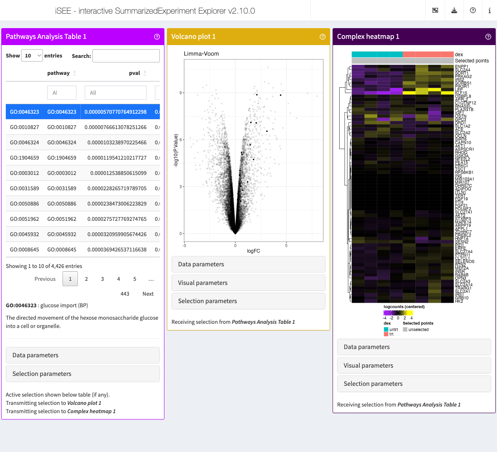

# Integration with other panels

## Scenario

In this vignette, we use the example of a differential expression and
pathway analysis workflow on a real data set to demonstrate how a
selection made in a panel of pathway analysis results may be transmitted
to other row-oriented panels in the
*[iSEE](https://bioconductor.org/packages/3.24/iSEE)* application.

## Demonstration

### Example data

### Experimental metadata

We use the [`?airway`](https://rdrr.io/pkg/airway/man/airway.html) data
set.

We briefly adjust the reference level of the treatment factor to the
untreated condition.

\
[`library`](https://rdrr.io/r/base/library.html)`(``"airway"``)`\
[`data`](https://rdrr.io/r/utils/data.html)`(``"airway"``)`\
`airway``$``dex`` ``<-`` `[`relevel`](https://rdrr.io/r/stats/relevel.html)`(``airway``$``dex``, ``"untrt"``)`

### Feature identifiers

We also map the Ensembl gene identifiers to more recognisable gene
symbols, setting row names to a unique identifier composed of either
gene symbol, gene identifier, of a concatenate of both.

Although not essential, this implicitly defines the primary piece of
information displayed for genes in the live app. No information is lost
in the process, as the original Ensembl identifier and the corresponding
gene symbol are both stored in the
[`rowData()`](https://rdrr.io/pkg/SummarizedExperiment/man/SummarizedExperiment-class.html)
of the object.

\
[`library`](https://rdrr.io/r/base/library.html)`(``"org.Hs.eg.db"``)`\
[`library`](https://rdrr.io/r/base/library.html)`(`[`"scater"`](http://bioconductor.org/packages/scater/)`)`\
[`rowData`](https://rdrr.io/pkg/SummarizedExperiment/man/SummarizedExperiment-class.html)`(``airway``)``[[``"ENSEMBL"``]``]`` ``<-`` `[`rownames`](https://rdrr.io/r/base/colnames.html)`(``airway``)`\
[`rowData`](https://rdrr.io/pkg/SummarizedExperiment/man/SummarizedExperiment-class.html)`(``airway``)``[[``"SYMBOL"``]``]`` ``<-`` `[`mapIds`](https://rdrr.io/pkg/AnnotationDbi/man/AnnotationDb-class.html)`(``org.Hs.eg.db``, `[`rownames`](https://rdrr.io/r/base/colnames.html)`(``airway``)``, ``"SYMBOL"``, ``"ENSEMBL"``)`\
[`rowData`](https://rdrr.io/pkg/SummarizedExperiment/man/SummarizedExperiment-class.html)`(``airway``)``[[``"uniquifyFeatureNames"``]``]`` ``<-`` `[`uniquifyFeatureNames`](https://rdrr.io/pkg/scuttle/man/uniquifyFeatureNames.html)`(`\
`  ID ``=`` `[`rowData`](https://rdrr.io/pkg/SummarizedExperiment/man/SummarizedExperiment-class.html)`(``airway``)``[[``"ENSEMBL"``]``]``,`\
`  names ``=`` `[`rowData`](https://rdrr.io/pkg/SummarizedExperiment/man/SummarizedExperiment-class.html)`(``airway``)``[[``"SYMBOL"``]``]`\
`)`\
[`rownames`](https://rdrr.io/r/base/colnames.html)`(``airway``)`` ``<-`` `[`rowData`](https://rdrr.io/pkg/SummarizedExperiment/man/SummarizedExperiment-class.html)`(``airway``)``[[``"uniquifyFeatureNames"``]``]`

### Gene expression

We also compute log-transformed counts, for a better visualisation of
differential expression in the live app.

\
[`library`](https://rdrr.io/r/base/library.html)`(`[`"scuttle"`](https://github.com/LTLA/scuttle)`)`\
`airway`` ``<-`` `[`logNormCounts`](https://rdrr.io/pkg/scuttle/man/logNormCounts.html)`(``airway``)`\
`#> Warning in .local(x, ...): 'logNormCounts' is deprecated.`\
`#> Use 'scrapper::normalizeRnaCounts.se' instead.`\
`#> See help("Deprecated")`\
`#> Warning in .local(x, ...): 'normalizeCounts' is deprecated.`\
`#> Use 'scrapper::normalizeCounts' instead.`\
`#> See help("Deprecated")`\
`#> Warning in .local(x, ...): 'librarySizeFactors' is deprecated.`\
`#> Use 'scrapper::centerSizeFactors' instead.`\
`#> See help("Deprecated")`

### Differential expression analysis

We run a standard Limma-Voom analysis using
[`limma::voom()`](https://rdrr.io/pkg/limma/man/voom.html),
[`limma::lmFit()`](https://rdrr.io/pkg/limma/man/lmFit.html),
[`limma::makeContrasts()`](https://rdrr.io/pkg/limma/man/makeContrasts.html),
and [`limma::eBayes()`](https://rdrr.io/pkg/limma/man/ebayes.html).

\
[`library`](https://rdrr.io/r/base/library.html)`(`[`"edgeR"`](https://bioinf.wehi.edu.au/edgeR/)`)`\
\
`counts`` ``<-`` `[`assay`](https://rdrr.io/pkg/SummarizedExperiment/man/SummarizedExperiment-class.html)`(``airway``, ``"counts"``)`\
`design`` ``<-`` `[`model.matrix`](https://rdrr.io/r/stats/model.matrix.html)`(``~`` ``0`` ``+`` ``dex`` ``+`` ``cell``, data ``=`` `[`colData`](https://rdrr.io/pkg/SummarizedExperiment/man/SummarizedExperiment-class.html)`(``airway``)``)`\
\
`keep`` ``<-`` `[`filterByExpr`](https://rdrr.io/pkg/edgeR/man/filterByExpr.html)`(``counts``, ``design``)`\
`v`` ``<-`` `[`voom`](https://rdrr.io/pkg/limma/man/voom.html)`(``counts``[``keep``,``]``, ``design``, plot``=``FALSE``)`\
`fit`` ``<-`` `[`lmFit`](https://rdrr.io/pkg/limma/man/lmFit.html)`(``v``, ``design``)`\
`contr`` ``<-`` `[`makeContrasts`](https://rdrr.io/pkg/limma/man/makeContrasts.html)`(``"dextrt - dexuntrt"``, levels ``=`` `[`colnames`](https://rdrr.io/pkg/BiocGenerics/man/row_colnames.html)`(`[`coef`](https://rdrr.io/r/stats/coef.html)`(``fit``)``)``)`\
`tmp`` ``<-`` `[`contrasts.fit`](https://rdrr.io/pkg/limma/man/contrasts.fit.html)`(``fit``, ``contr``)`\
`tmp`` ``<-`` `[`eBayes`](https://rdrr.io/pkg/limma/man/ebayes.html)`(``tmp``)`\
`res_limma`` ``<-`` `[`topTable`](https://rdrr.io/pkg/limma/man/toptable.html)`(``tmp``, sort.by ``=`` ``"P"``, n ``=`` ``Inf``)`\
[`head`](https://rdrr.io/r/utils/head.html)`(``res_limma``)`\
`#>             logFC  AveExpr         t      P.Value    adj.P.Val        B`\
`#> CACNB2   3.205582 3.682244  36.60079 2.137481e-11 3.603794e-07 16.17300`\
`#> DUSP1    2.864813 6.644455  28.95810 1.867716e-10 8.660658e-07 14.74054`\
`#> MAOA     3.257581 5.950559  28.34252 2.277611e-10 8.660658e-07 14.53525`\
`#> SPARCL1  4.489229 4.166904  28.07264 2.487930e-10 8.660658e-07 14.13243`\
`#> PRSS35  -2.828191 3.224885 -27.59003 2.919696e-10 8.660658e-07 13.93532`\
`#> STEAP2   1.894509 6.790009  26.83769 3.767814e-10 8.660658e-07 14.07952`

Then, we embed this set of differential expression results in the
[`?airway`](https://rdrr.io/pkg/airway/man/airway.html) object using the
[`iSEEde::embedContrastResults()`](https://rdrr.io/pkg/iSEEde/man/utils-SummarizedExperiment.html)
method.

\
[`library`](https://rdrr.io/r/base/library.html)`(`[`"iSEEde"`](https://github.com/iSEE/iSEEde)`)`\
`#> Loading required package: iSEE`\
`airway`` ``<-`` ``iSEEde``::`[`embedContrastResults`](https://rdrr.io/pkg/iSEEde/man/utils-SummarizedExperiment.html)`(``res_limma``, ``airway``, name ``=`` ``"Limma-Voom"``, class ``=`` ``"limma"``)`\
[`rowData`](https://rdrr.io/pkg/SummarizedExperiment/man/SummarizedExperiment-class.html)`(``airway``)`\
`#> DataFrame with 63677 rows and 14 columns`\
`#>                         gene_id     gene_name  entrezid   gene_biotype`\
`#>                     <character>   <character> <integer>    <character>`\
`#> TSPAN6          ENSG00000000003        TSPAN6        NA protein_coding`\
`#> TNMD            ENSG00000000005          TNMD        NA protein_coding`\
`#> DPM1            ENSG00000000419          DPM1        NA protein_coding`\
`#> SCYL3           ENSG00000000457         SCYL3        NA protein_coding`\
`#> FIRRM           ENSG00000000460      C1orf112        NA protein_coding`\
`#> ...                         ...           ...       ...            ...`\
`#> ENSG00000273489 ENSG00000273489 RP11-180C16.1        NA      antisense`\
`#> ENSG00000273490 ENSG00000273490        TSEN34        NA protein_coding`\
`#> ENSG00000273491 ENSG00000273491  RP11-138A9.2        NA        lincRNA`\
`#> APP-DT          ENSG00000273492    AP000230.1        NA        lincRNA`\
`#> ENSG00000273493 ENSG00000273493  RP11-80H18.4        NA        lincRNA`\
`#>                 gene_seq_start gene_seq_end              seq_name seq_strand`\
`#>                      <integer>    <integer>           <character>  <integer>`\
`#> TSPAN6                99883667     99894988                     X         -1`\
`#> TNMD                  99839799     99854882                     X          1`\
`#> DPM1                  49551404     49575092                    20         -1`\
`#> SCYL3                169818772    169863408                     1         -1`\
`#> FIRRM                169631245    169823221                     1          1`\
`#> ...                        ...          ...                   ...        ...`\
`#> ENSG00000273489      131178723    131182453                     7         -1`\
`#> ENSG00000273490       54693789     54697585 HSCHR19LRC_LRC_J_CTG1          1`\
`#> ENSG00000273491      130600118    130603315          HG1308_PATCH          1`\
`#> APP-DT                27543189     27589700                    21          1`\
`#> ENSG00000273493       58315692     58315845                     3          1`\
`#>                 seq_coord_system        symbol         ENSEMBL      SYMBOL`\
`#>                        <integer>   <character>     <character> <character>`\
`#> TSPAN6                        NA        TSPAN6 ENSG00000000003      TSPAN6`\
`#> TNMD                          NA          TNMD ENSG00000000005        TNMD`\
`#> DPM1                          NA          DPM1 ENSG00000000419        DPM1`\
`#> SCYL3                         NA         SCYL3 ENSG00000000457       SCYL3`\
`#> FIRRM                         NA      C1orf112 ENSG00000000460       FIRRM`\
`#> ...                          ...           ...             ...         ...`\
`#> ENSG00000273489               NA RP11-180C16.1 ENSG00000273489          NA`\
`#> ENSG00000273490               NA        TSEN34 ENSG00000273490          NA`\
`#> ENSG00000273491               NA  RP11-138A9.2 ENSG00000273491          NA`\
`#> APP-DT                        NA    AP000230.1 ENSG00000273492      APP-DT`\
`#> ENSG00000273493               NA  RP11-80H18.4 ENSG00000273493          NA`\
`#>                 uniquifyFeatureNames             iSEEde`\
`#>                          <character>        <DataFrame>`\
`#> TSPAN6                        TSPAN6 <iSEELimmaResults>`\
`#> TNMD                            TNMD <iSEELimmaResults>`\
`#> DPM1                            DPM1 <iSEELimmaResults>`\
`#> SCYL3                          SCYL3 <iSEELimmaResults>`\
`#> FIRRM                          FIRRM <iSEELimmaResults>`\
`#> ...                              ...                ...`\
`#> ENSG00000273489      ENSG00000273489 <iSEELimmaResults>`\
`#> ENSG00000273490      ENSG00000273490 <iSEELimmaResults>`\
`#> ENSG00000273491      ENSG00000273491 <iSEELimmaResults>`\
`#> APP-DT                        APP-DT <iSEELimmaResults>`\
`#> ENSG00000273493      ENSG00000273493 <iSEELimmaResults>`

### Pathways

We prepare Gene Ontology gene sets of biological pathways using
*[org.Hs.eg.db](https://bioconductor.org/packages/3.24/org.Hs.eg.db)*.

Due to the use of
[`uniquifyFeatureNames()`](https://rdrr.io/pkg/scuttle/man/uniquifyFeatureNames.html)
above, we must first map pathway identifiers to the unique Ensembl gene
identifier, to accurately perform pathway analysis using the feature
identifiers matching those of the embedded differential expression
results.

\
[`library`](https://rdrr.io/r/base/library.html)`(``"org.Hs.eg.db"``)`\
`pathways`` ``<-`` `[`select`](https://rdrr.io/pkg/AnnotationDbi/man/AnnotationDb-class.html)`(``org.Hs.eg.db``, `[`keys`](https://rdrr.io/pkg/AnnotationDbi/man/AnnotationDb-class.html)`(``org.Hs.eg.db``, ``"ENSEMBL"``)``, `[`c`](https://rdrr.io/r/base/c.html)`(``"GOALL"``)``, keytype ``=`` ``"ENSEMBL"``)`\
`#> 'select()' returned 1:many mapping between keys and columns`\
`pathways`` ``<-`` `[`subset`](https://rdrr.io/r/base/subset.html)`(``pathways``, ``ONTOLOGYALL`` ``==`` ``"BP"``)`\
`pathways`` ``<-`` `[`unique`](https://rdrr.io/r/base/unique.html)`(``pathways``[``, `[`c`](https://rdrr.io/r/base/c.html)`(``"ENSEMBL"``, ``"GOALL"``)``]``)`\
`pathways`` ``<-`` `[`merge`](https://rdrr.io/r/base/merge.html)`(``pathways``, `[`rowData`](https://rdrr.io/pkg/SummarizedExperiment/man/SummarizedExperiment-class.html)`(``airway``)``[``, `[`c`](https://rdrr.io/r/base/c.html)`(``"ENSEMBL"``, ``"uniquifyFeatureNames"``)``]``)`\
`pathways`` ``<-`` `[`split`](https://rdrr.io/r/base/split.html)`(``pathways``$``uniquifyFeatureNames``, ``pathways``$``GOALL``)`

### Mapping pathways to genes

Separately, we define and register a function that fetches the gene
identifiers associated with a given pathway identifier. This function is
required to transmit selections from pathway-level panels to
feature-level panels.

Due to the use of
[`uniquifyFeatureNames()`](https://rdrr.io/pkg/scuttle/man/uniquifyFeatureNames.html)
above, the function must first map to the unique Ensembl gene
identifier, to accurately identify the corresponding value in
`rownames(airway)`.

\
`map_GO`` ``<-`` ``function``(``pathway_id``, ``se``)`` ``{`\
`    ``pathway_ensembl`` ``<-`` `[`mapIds`](https://rdrr.io/pkg/AnnotationDbi/man/AnnotationDb-class.html)`(``org.Hs.eg.db``, ``pathway_id``, ``"ENSEMBL"``, keytype ``=`` ``"GOALL"``, multiVals ``=`` ``"CharacterList"``)``[[``pathway_id``]``]`\
`    ``pathway_rownames`` ``<-`` `[`rownames`](https://rdrr.io/r/base/colnames.html)`(``se``)``[`[`rowData`](https://rdrr.io/pkg/SummarizedExperiment/man/SummarizedExperiment-class.html)`(``se``)``[[``"gene_id"``]``]`` `[`%in%`](https://rdrr.io/r/base/match.html)` ``pathway_ensembl``]`\
`    ``pathway_rownames`\
`}`\
`airway`` ``<-`` `[`registerAppOptions`](https://isee.github.io/iSEE/reference/registerAppOptions.html)`(``airway``, Pathways.map.functions ``=`` `[`list`](https://rdrr.io/r/base/list.html)`(``GO ``=`` ``map_GO``)``)`

### Gene set enrichment analysis

We run a standard GSEA analysis using
*[fgsea](https://bioconductor.org/packages/3.24/fgsea)*.

\
[`library`](https://rdrr.io/r/base/library.html)`(`[`"fgsea"`](https://github.com/alserglab/fgsea/)`)`\
[`set.seed`](https://rdrr.io/r/base/Random.html)`(``42``)`\
`stats`` ``<-`` `[`na.omit`](https://rdrr.io/r/stats/na.fail.html)`(`[`log2FoldChange`](https://rdrr.io/pkg/iSEEde/man/de-generics.html)`(`[`contrastResults`](https://rdrr.io/pkg/iSEEde/man/contrastResults.html)`(``airway``, ``"Limma-Voom"``)``)``)`\
`fgseaRes`` ``<-`` `[`fgsea`](https://rdrr.io/pkg/fgsea/man/fgsea.html)`(``pathways ``=`` ``pathways``, `\
`                  stats    ``=`` ``stats``,`\
`                  minSize  ``=`` ``15``,`\
`                  maxSize  ``=`` ``500``)`\
`#> Warning in prepareStats(stats, scoreType, gseaParam): There are ties in the preranked stats (0.05% of the list).`\
`#> The order of those tied genes will be arbitrary, which may produce unexpected results.`\
[`head`](https://rdrr.io/r/utils/head.html)`(``fgseaRes``[`[`order`](https://rdrr.io/r/base/order.html)`(``pval``)``, ``]``)`\
`#>       pathway         pval        padj   log2err        ES      NES  size`\
`#>        <char>        <num>       <num>     <num>     <num>    <num> <int>`\
`#> 1: GO:0014888 3.376512e-07 0.001340138 0.6749629 0.8497718 2.319589    21`\
`#> 2: GO:0003012 7.991580e-06 0.015859290 0.5933255 0.3878205 1.675330   314`\
`#> 3: GO:0014896 2.473850e-05 0.021685979 0.5756103 0.6024132 2.062956    64`\
`#> 4: GO:0014897 2.550245e-05 0.021685979 0.5756103 0.5934240 2.023012    62`\
`#> 5: GO:0043500 3.128382e-05 0.021685979 0.5573322 0.5767384 2.029781    70`\
`#> 6: GO:0032869 3.278304e-05 0.021685979 0.5573322 0.4505230 1.786358   157`\
`#>                                      leadingEdge`\
`#>                                           <list>`\
`#> 1:    KLF15,ERRFI1,FOXO1,MYOZ2,MSTN,CFLAR,...[8]`\
`#> 2:  KLF15,ADRA1B,CACNB2,LEP,MYH13,ERRFI1,...[81]`\
`#> 3:   KLF15,ADRA1B,LEP,ERRFI1,FOXO1,NR4A3,...[15]`\
`#> 4:   KLF15,ADRA1B,LEP,ERRFI1,FOXO1,NR4A3,...[14]`\
`#> 5: KLF15,ADRA1B,ERRFI1,FOXO1,MYOZ2,NR4A3,...[18]`\
`#> 6:      INHBB,LEP,PDK4,ERRFI1,FOXO1,IRS2,...[50]`

Then, we embed this set of pathway analysis results in the `airway`
object, using the
[`?iSEEpathways::embedPathwaysResults`](https://isee.github.io/iSEEpathways/reference/utils-SummarizedExperiment.md)
method.

But first, we reorder the results by increasing p-value. Although not
essential, this implicitly defines the default ordering of the table in
the live app.

\
[`library`](https://rdrr.io/r/base/library.html)`(`[`"iSEEpathways"`](https://github.com/iSEE/iSEEpathways)`)`\
`fgseaRes`` ``<-`` ``fgseaRes``[`[`order`](https://rdrr.io/r/base/order.html)`(``pval``)``, ``]`\
`airway`` ``<-`` `[`embedPathwaysResults`](https://isee.github.io/iSEEpathways/reference/utils-SummarizedExperiment.md)`(`\
`  ``fgseaRes``, ``airway``, name ``=`` ``"fgsea (p-value)"``, class ``=`` ``"fgsea"``,`\
`  pathwayType ``=`` ``"GO"``, pathwaysList ``=`` ``pathways``, featuresStats ``=`` ``stats``)`\
`airway`\
`#> class: RangedSummarizedExperiment `\
`#> dim: 63677 8 `\
`#> metadata(3): '' iSEE iSEEpathways`\
`#> assays(2): counts logcounts`\
`#> rownames(63677): TSPAN6 TNMD ... APP-DT ENSG00000273493`\
`#> rowData names(14): gene_id gene_name ... uniquifyFeatureNames iSEEde`\
`#> colnames(8): SRR1039508 SRR1039509 ... SRR1039520 SRR1039521`\
`#> colData names(9): SampleName cell ... Sample BioSample`

To showcase a choice of pathway analysis results in the live app, we
repeat the process above, this time sorting by a different score that
combines the log-transformed p-value and the absolute log-transformed
fold-change.

\
`stats`` ``<-`` `[`na.omit`](https://rdrr.io/r/stats/na.fail.html)`(`\
`  `[`log2FoldChange`](https://rdrr.io/pkg/iSEEde/man/de-generics.html)`(`[`contrastResults`](https://rdrr.io/pkg/iSEEde/man/contrastResults.html)`(``airway``, ``"Limma-Voom"``)``)`` ``*`\
`  ``-`[`log10`](https://rdrr.io/r/base/Log.html)`(`[`pValue`](https://rdrr.io/pkg/iSEEde/man/de-generics.html)`(`[`contrastResults`](https://rdrr.io/pkg/iSEEde/man/contrastResults.html)`(``airway``, ``"Limma-Voom"``)``)``)`\
`)`\
[`set.seed`](https://rdrr.io/r/base/Random.html)`(``42``)`\
`fgseaRes`` ``<-`` `[`fgsea`](https://rdrr.io/pkg/fgsea/man/fgsea.html)`(``pathways ``=`` ``pathways``, `\
`                  stats    ``=`` `[`na.omit`](https://rdrr.io/r/stats/na.fail.html)`(``stats``)``,`\
`                  minSize  ``=`` ``15``,`\
`                  maxSize  ``=`` ``500``)`\
`fgseaRes`` ``<-`` ``fgseaRes``[`[`order`](https://rdrr.io/r/base/order.html)`(``pval``)``, ``]`\
`airway`` ``<-`` `[`embedPathwaysResults`](https://isee.github.io/iSEEpathways/reference/utils-SummarizedExperiment.md)`(`\
`  ``fgseaRes``, ``airway``, name ``=`` ``"fgsea (p-value & fold-change)"``, class ``=`` ``"fgsea"``,`\
`  pathwayType ``=`` ``"GO"``, pathwaysList ``=`` ``pathways``, featuresStats ``=`` ``stats``)`\
`airway`\
`#> class: RangedSummarizedExperiment `\
`#> dim: 63677 8 `\
`#> metadata(3): '' iSEE iSEEpathways`\
`#> assays(2): counts logcounts`\
`#> rownames(63677): TSPAN6 TNMD ... APP-DT ENSG00000273493`\
`#> rowData names(14): gene_id gene_name ... uniquifyFeatureNames iSEEde`\
`#> colnames(8): SRR1039508 SRR1039509 ... SRR1039520 SRR1039521`\
`#> colData names(9): SampleName cell ... Sample BioSample`

### Displaying additional pathway information

For further user-friendliness in the live app, we define and register a
function that displays details for the selected Gene Ontology gene set
using the *[GO.db](https://bioconductor.org/packages/3.24/GO.db)*
package.

\
[`library`](https://rdrr.io/r/base/library.html)`(``"GO.db"``)`\
`#> `\
[`library`](https://rdrr.io/r/base/library.html)`(`[`"shiny"`](https://shiny.posit.co/)`)`\
`#> `\
`#> Attaching package: 'shiny'`\
`#> The following object is masked from 'package:BiocStyle':`\
`#> `\
`#>     markdown`\
[`library`](https://rdrr.io/r/base/library.html)`(`[`"iSEE"`](https://isee.github.io/iSEE/)`)`\
`go_details`` ``<-`` ``function``(``x``)`` ``{`\
`    ``info`` ``<-`` `[`select`](https://rdrr.io/pkg/AnnotationDbi/man/AnnotationDb-class.html)`(``GO.db``, ``x``, `[`c`](https://rdrr.io/r/base/c.html)`(``"TERM"``, ``"ONTOLOGY"``, ``"DEFINITION"``)``, ``"GOID"``)`\
`    ``html`` ``<-`` `[`list`](https://rdrr.io/r/base/list.html)`(`[`p`](https://rstudio.github.io/htmltools/reference/builder.html)`(`[`strong`](https://rstudio.github.io/htmltools/reference/builder.html)`(``info``$``GOID``)``, ``":"``, ``info``$``TERM``, `[`paste0`](https://rdrr.io/r/base/paste.html)`(``"("``, ``info``$``ONTOLOGY``, ``")"``)``)``)`\
`    ``if`` ``(``!`[`is.na`](https://rdrr.io/r/base/NA.html)`(``info``$``DEFINITION``)``)`` ``{`\
`        ``html`` ``<-`` `[`append`](https://rdrr.io/r/base/append.html)`(``html``, `[`list`](https://rdrr.io/r/base/list.html)`(`[`p`](https://rstudio.github.io/htmltools/reference/builder.html)`(``info``$``DEFINITION``)``)``)`\
`    ``}`\
`    `[`tagList`](https://rstudio.github.io/htmltools/reference/tagList.html)`(``html``)`\
`}`\
`airway`` ``<-`` `[`registerAppOptions`](https://isee.github.io/iSEE/reference/registerAppOptions.html)`(``airway``, PathwaysTable.select.details ``=`` ``go_details``)`

### Live app

Finally, we configure the initial state and launch the live app.

\
`app`` ``<-`` `[`iSEE`](https://isee.github.io/iSEE/reference/iSEE.html)`(``airway``, initial ``=`` `[`list`](https://rdrr.io/r/base/list.html)`(`\
`  `[`PathwaysTable`](https://isee.github.io/iSEEpathways/reference/PathwaysTable-class.md)`(``ResultName``=``"fgsea (p-value)"``, Selected ``=`` ``"GO:0046324"``, PanelWidth ``=`` ``4L``)``,`\
`  `[`VolcanoPlot`](https://rdrr.io/pkg/iSEEde/man/VolcanoPlot-class.html)`(``RowSelectionSource ``=`` ``"PathwaysTable1"``, ColorBy ``=`` ``"Row selection"``, PanelWidth ``=`` ``4L``)``,`\
`  `[`ComplexHeatmapPlot`](https://isee.github.io/iSEE/reference/ComplexHeatmapPlot-class.html)`(``RowSelectionSource ``=`` ``"PathwaysTable1"``,`\
`      PanelWidth ``=`` ``4L``, PanelHeight ``=`` ``700L``,`\
`      CustomRows ``=`` ``FALSE``, ColumnData ``=`` ``"dex"``,`\
`      ClusterRows ``=`` ``TRUE``, ClusterRowsDistance ``=`` ``"euclidean"``, AssayCenterRows ``=`` ``TRUE``)``,`\
`  `[`FgseaEnrichmentPlot`](https://isee.github.io/iSEEpathways/reference/FgseaEnrichmentPlot-class.md)`(``ResultName``=``"fgsea (p-value)"``, PathwayId ``=`` ``"GO:0046324"``, PanelWidth ``=`` ``12L``)`\
`)``)`\
\
`if`` ``(`[`interactive`](https://rdrr.io/r/base/interactive.html)`(``)``)`` ``{`\
`  ``shiny``::`[`runApp`](https://rdrr.io/pkg/shiny/man/runApp.html)`(``app``)`\
`}`

## Trading off memory usage for speed

The function `map_GO()` that we defined earlier above – to map a pathway
identifier to a set of gene identifiers – uses the
*[org.Hs.eg.db](https://bioconductor.org/packages/3.24/org.Hs.eg.db)*
package and the `?AnnotationDbi::select()` function.

While memory-efficient, the repeated calls to the database of gene
annotations introduce a bottleneck that limits the reactivity of the
app.

We can improve the speed of the app rendering by trading off an
increased memory usage. Specifically, we can use the object `pathways`
that we created earlier as a named list of pathway identifiers and
character vectors of gene identifiers associated with each pathway,
instead of querying the `GO.db` database.

First, for the app to be self-contained, the list of pathways should be
stored within the `airway` object itself. For instance, we store those
in the
[`metadata()`](https://pkgs.rstudio.com/rmarkdown/reference/metadata.html)
of the `airway` object.

\
[`metadata`](https://pkgs.rstudio.com/rmarkdown/reference/metadata.html)`(``airway``)``[[``"pathways"``]``]`` ``<-`` `[`list`](https://rdrr.io/r/base/list.html)`(``GO ``=`` ``pathways``)`

Then, we can write a new, faster, function that fetches gene identifiers
directly from that list rather than the database. The function should
take as first argument a single pathway identifier, and the second
argument must be called `se` to match the name of the
`SummarizedExperiment` object used within the app.

As a a trade off, the app now relies on the list of pathway annotations
being available in the metadata of the `se` object, using additional
memory for the benefit of dramatically faster access.

\
`map_GO_v2`` ``<-`` ``function``(``pathway_id``, ``se``)`` ``{`\
`    ``pathway_list`` ``<-`` `[`metadata`](https://pkgs.rstudio.com/rmarkdown/reference/metadata.html)`(``se``)``[[``"pathways"``]``]``[[``"GO"``]``]`\
`    ``if`` ``(``!``pathway_id`` `[`%in%`](https://rdrr.io/r/base/match.html)` `[`names`](https://rdrr.io/r/base/names.html)`(``pathway_list``)``)`` ``{`\
`        `[`warning`](https://rdrr.io/r/base/warning.html)`(``"Pathway identifier %s not found."``, `[`sQuote`](https://rdrr.io/r/base/sQuote.html)`(``pathway_id``)``)`\
`        `[`return`](https://rdrr.io/r/base/function.html)`(`[`character`](https://rdrr.io/r/base/character.html)`(``0``)``)`\
`    ``}`\
`    ``pathway_list``[[``pathway_id``]``]`\
`}`\
`airway`` ``<-`` `[`registerAppOptions`](https://isee.github.io/iSEE/reference/registerAppOptions.html)`(``airway``, Pathways.map.functions ``=`` `[`list`](https://rdrr.io/r/base/list.html)`(``GO ``=`` ``map_GO_v2``)``)`

We can then launch a new instance of the app, using the same initial
configuration, but the update `airway` object.

\
`app`` ``<-`` `[`iSEE`](https://isee.github.io/iSEE/reference/iSEE.html)`(``airway``, initial ``=`` `[`list`](https://rdrr.io/r/base/list.html)`(`\
`  `[`PathwaysTable`](https://isee.github.io/iSEEpathways/reference/PathwaysTable-class.md)`(``ResultName``=``"fgsea (p-value)"``, Selected ``=`` ``"GO:0046324"``, PanelWidth ``=`` ``4L``)``,`\
`  `[`VolcanoPlot`](https://rdrr.io/pkg/iSEEde/man/VolcanoPlot-class.html)`(``RowSelectionSource ``=`` ``"PathwaysTable1"``, ColorBy ``=`` ``"Row selection"``, PanelWidth ``=`` ``4L``)``,`\
`  `[`ComplexHeatmapPlot`](https://isee.github.io/iSEE/reference/ComplexHeatmapPlot-class.html)`(``RowSelectionSource ``=`` ``"PathwaysTable1"``,`\
`      PanelWidth ``=`` ``4L``, PanelHeight ``=`` ``700L``,`\
`      CustomRows ``=`` ``FALSE``, ColumnData ``=`` ``"dex"``,`\
`      ClusterRows ``=`` ``TRUE``, ClusterRowsDistance ``=`` ``"euclidean"``, AssayCenterRows ``=`` ``TRUE``)``,`\
`  `[`FgseaEnrichmentPlot`](https://isee.github.io/iSEEpathways/reference/FgseaEnrichmentPlot-class.md)`(``ResultName``=``"fgsea (p-value)"``, PathwayId ``=`` ``"GO:0046324"``, PanelWidth ``=`` ``12L``)`\
`)``)`\
\
`if`` ``(`[`interactive`](https://rdrr.io/r/base/interactive.html)`(``)``)`` ``{`\
`  ``shiny``::`[`runApp`](https://rdrr.io/pkg/shiny/man/runApp.html)`(``app``)`\
`}`

## Reproducibility

The
*[iSEEpathways](https://bioconductor.org/packages/3.24/iSEEpathways)*
package (Rue-Albrecht and Soneson, 2024) was made possible thanks to:

- R (R Core Team, 2026)
- *[BiocStyle](https://bioconductor.org/packages/3.24/BiocStyle)* (Oleś,
  2026)
- *[knitr](https://CRAN.R-project.org/package=knitr)* (Xie, 2026)
- *[RefManageR](https://CRAN.R-project.org/package=RefManageR)* (McLean,
  2017)
- *[rmarkdown](https://CRAN.R-project.org/package=rmarkdown)* (Allaire,
  Xie, Dervieux, McPherson, Luraschi, Ushey, Atkins, Wickham, Cheng,
  Chang, and Iannone, 2026)
- *[sessioninfo](https://CRAN.R-project.org/package=sessioninfo)*
  (Wickham, Chang, Flight, Müller, and Hester, 2026)
- *[testthat](https://CRAN.R-project.org/package=testthat)* (Wickham,
  2011)

This package was developed using
*[biocthis](https://bioconductor.org/packages/3.24/biocthis)*.

Code for creating the vignette

\
`## Create the vignette`\
[`library`](https://rdrr.io/r/base/library.html)`(`[`"rmarkdown"`](https://github.com/rstudio/rmarkdown)`)`\
[`system.time`](https://rdrr.io/r/base/system.time.html)`(`[`render`](https://pkgs.rstudio.com/rmarkdown/reference/render.html)`(``"integration.Rmd"``, ``"BiocStyle::html_document"``)``)`\
\
`## Extract the R code`\
[`library`](https://rdrr.io/r/base/library.html)`(`[`"knitr"`](https://yihui.org/knitr/)`)`\
[`knit`](https://rdrr.io/pkg/knitr/man/knit.html)`(``"integration.Rmd"``, tangle ``=`` ``TRUE``)`

Date the vignette was generated.

    #> [1] "2026-10-22 14:14:43 UTC"

Wallclock time spent generating the vignette.

    #> Time difference of 1.065 mins

`R` session information.

    #> ─ Session info ───────────────────────────────────────────────────────────────────────────────────────────────────────
    #>  setting  value
    #>  version  R version 4.6.1 (2026-06-24)
    #>  os       Ubuntu 24.04.5 LTS
    #>  system   x86_64, linux-gnu
    #>  ui       X11
    #>  language en
    #>  collate  en_US.UTF-8
    #>  ctype    en_US.UTF-8
    #>  tz       UTC
    #>  date     2026-10-22
    #>  pandoc   3.12.1 @ /usr/bin/ (via rmarkdown)
    #>  quarto   1.10.18 @ /usr/local/bin/quarto
    #> 
    #> ─ Packages ───────────────────────────────────────────────────────────────────────────────────────────────────────────
    #>  package              * version  date (UTC) lib source
    #>  abind                  1.4-8    2024-09-12 [1] RSPM (R 4.6.0)
    #>  airway               * 1.33.2   2026-07-21 [1] Bioconductor 3.24 (R 4.6.1)
    #>  AnnotationDbi        * 1.75.2   2026-07-21 [1] Bioconductor 3.24 (R 4.6.1)
    #>  beachmat               2.29.3   2026-09-23 [1] Bioconductor 3.24 (R 4.6.1)
    #>  beeswarm               0.4.0    2021-06-01 [1] RSPM (R 4.6.0)
    #>  bibtex                 0.5.3    2026-09-22 [1] RSPM (R 4.6.0)
    #>  Biobase              * 2.73.2   2026-07-29 [1] Bioconductor 3.24 (R 4.6.1)
    #>  BiocBaseUtils          1.15.1   2026-05-10 [1] Bioconductor 3.24 (R 4.6.1)
    #>  BiocGenerics         * 0.59.12  2026-08-11 [1] Bioconductor 3.24 (R 4.6.1)
    #>  BiocManager            1.30.27  2025-11-14 [2] CRAN (R 4.6.1)
    #>  BiocNeighbors          2.7.3    2026-08-21 [1] Bioconductor 3.24 (R 4.6.1)
    #>  BiocParallel           1.47.0   2026-04-28 [1] Bioconductor 3.24 (R 4.6.1)
    #>  BiocSingular           1.29.2   2026-10-08 [1] Bioconductor 3.24 (R 4.6.1)
    #>  BiocStyle            * 2.41.0   2026-04-28 [1] Bioconductor 3.24 (R 4.6.1)
    #>  Biostrings             2.81.9   2026-09-06 [1] Bioconductor 3.24 (R 4.6.1)
    #>  bit                    4.6.0    2025-03-06 [1] RSPM (R 4.6.0)
    #>  bit64                  4.8.6    2026-09-01 [1] RSPM (R 4.6.0)
    #>  blob                   1.3.0    2026-01-14 [1] RSPM (R 4.6.0)
    #>  bookdown               0.48     2026-08-28 [1] RSPM (R 4.6.0)
    #>  bslib                  0.12.0   2026-08-04 [2] RSPM (R 4.6.0)
    #>  cachem                 1.1.0    2024-05-16 [2] RSPM (R 4.6.0)
    #>  circlize               0.4.18   2026-04-04 [1] RSPM (R 4.6.0)
    #>  cli                    3.6.6    2026-04-09 [2] RSPM (R 4.6.0)
    #>  clue                   0.3-68   2026-03-26 [1] RSPM (R 4.6.0)
    #>  cluster                2.1.8.3  2026-07-30 [2] RSPM (R 4.6.0)
    #>  codetools              0.2-20   2024-03-31 [3] CRAN (R 4.6.1)
    #>  colorspace             2.1-4    2026-10-08 [1] RSPM (R 4.6.0)
    #>  colourpicker           1.3.0    2023-08-21 [1] RSPM (R 4.6.0)
    #>  ComplexHeatmap         2.29.0   2026-04-28 [1] Bioconductor 3.24 (R 4.6.1)
    #>  cowplot                1.2.0    2025-07-07 [1] RSPM (R 4.6.0)
    #>  crayon                 1.5.3    2024-06-20 [2] RSPM (R 4.6.0)
    #>  data.table             1.18.6.1 2026-08-24 [1] RSPM (R 4.6.0)
    #>  DBI                    1.3.0    2026-02-25 [1] RSPM (R 4.6.0)
    #>  DelayedArray           0.39.8   2026-09-30 [1] Bioconductor 3.24 (R 4.6.1)
    #>  desc                   1.4.3    2023-12-10 [2] RSPM (R 4.6.0)
    #>  DESeq2                 1.53.6   2026-10-02 [1] Bioconductor 3.24 (R 4.6.1)
    #>  digest                 0.6.39   2025-11-19 [2] RSPM (R 4.6.0)
    #>  doParallel             1.0.17   2022-02-07 [1] RSPM (R 4.6.0)
    #>  dplyr                  1.2.1    2026-04-03 [1] RSPM (R 4.6.0)
    #>  DT                     0.34.0   2025-09-02 [1] RSPM (R 4.6.0)
    #>  edgeR                * 4.99.10  2026-10-18 [1] Bioconductor 3.24 (R 4.6.1)
    #>  evaluate               1.0.5    2025-08-27 [2] RSPM (R 4.6.0)
    #>  farver                 2.1.2    2024-05-13 [1] RSPM (R 4.6.0)
    #>  fastmap                1.2.0    2024-05-15 [2] RSPM (R 4.6.0)
    #>  fastmatch              1.1-8    2026-01-17 [1] RSPM (R 4.6.0)
    #>  fgsea                * 1.39.2   2026-06-26 [1] Bioconductor 3.24 (R 4.6.1)
    #>  fontawesome            0.5.3    2024-11-16 [2] RSPM (R 4.6.0)
    #>  foreach                1.5.2    2022-02-02 [1] RSPM (R 4.6.0)
    #>  fs                     2.1.0    2026-04-18 [2] RSPM (R 4.6.0)
    #>  generics             * 0.1.4    2025-05-09 [1] RSPM (R 4.6.0)
    #>  GenomicRanges        * 1.65.4   2026-09-02 [1] Bioconductor 3.24 (R 4.6.1)
    #>  GetoptLong             1.1.1    2026-04-08 [1] RSPM (R 4.6.0)
    #>  ggbeeswarm             0.7.3    2025-11-29 [1] RSPM (R 4.6.0)
    #>  ggplot2              * 4.0.3    2026-04-22 [1] RSPM (R 4.6.0)
    #>  ggrepel                0.9.8    2026-03-17 [1] RSPM (R 4.6.0)
    #>  GlobalOptions          0.1.4    2026-04-08 [1] RSPM (R 4.6.0)
    #>  glue                   1.8.1    2026-04-17 [2] RSPM (R 4.6.0)
    #>  GO.db                * 3.23.1   2026-07-20 [1] Bioconductor
    #>  gridExtra              2.3.1    2026-06-25 [1] RSPM (R 4.6.0)
    #>  gtable                 0.3.6    2024-10-25 [1] RSPM (R 4.6.0)
    #>  htmltools              0.5.9    2025-12-04 [2] RSPM (R 4.6.0)
    #>  htmlwidgets            1.6.4    2023-12-06 [2] RSPM (R 4.6.0)
    #>  httpuv                 1.6.17   2026-03-18 [2] RSPM (R 4.6.0)
    #>  httr                   1.4.9    2026-09-01 [1] RSPM (R 4.6.0)
    #>  igraph                 2.3.4    2026-09-30 [1] RSPM (R 4.6.0)
    #>  IRanges              * 2.47.5   2026-08-27 [1] Bioconductor 3.24 (R 4.6.1)
    #>  irlba                  2.4.1    2026-10-05 [1] RSPM (R 4.6.0)
    #>  iSEE                 * 2.25.1   2026-07-13 [1] Bioconductor 3.24 (R 4.6.1)
    #>  iSEEde               * 1.11.0   2026-10-22 [1] Github (iSEE/iSEEde@ce821d1)
    #>  iSEEpathways         * 1.11.0   2026-10-22 [1] Bioconductor
    #>  iterators              1.0.14   2022-02-05 [1] RSPM (R 4.6.0)
    #>  jquerylib              0.1.4    2021-04-26 [2] RSPM (R 4.6.0)
    #>  jsonlite               2.0.0    2025-03-27 [2] RSPM (R 4.6.0)
    #>  KEGGREST               1.53.6   2026-07-23 [1] Bioconductor 3.24 (R 4.6.1)
    #>  knitr                  1.52     2026-09-06 [2] RSPM (R 4.6.0)
    #>  later                  1.4.8    2026-03-05 [2] RSPM (R 4.6.0)
    #>  lattice                0.23-1   2026-08-12 [2] RSPM (R 4.6.0)
    #>  lifecycle              1.0.5    2026-01-08 [2] RSPM (R 4.6.0)
    #>  limma                * 3.99.2   2026-10-13 [1] Bioconductor 3.24 (R 4.6.1)
    #>  listviewer             4.0.0    2023-09-30 [1] RSPM (R 4.6.0)
    #>  locfit                 1.5-9.12 2025-03-05 [1] RSPM (R 4.6.0)
    #>  lubridate              1.9.5    2026-02-04 [1] RSPM (R 4.6.0)
    #>  magrittr               2.0.5    2026-04-04 [2] RSPM (R 4.6.0)
    #>  Matrix                 1.7-6    2026-07-25 [2] RSPM (R 4.6.0)
    #>  MatrixGenerics       * 1.25.0   2026-04-28 [1] Bioconductor 3.24 (R 4.6.1)
    #>  matrixStats          * 1.5.0    2025-01-07 [1] RSPM (R 4.6.0)
    #>  memoise                2.0.1    2021-11-26 [2] RSPM (R 4.6.0)
    #>  mgcv                   1.9-4    2025-11-07 [3] CRAN (R 4.6.1)
    #>  mime                   0.13     2025-03-17 [2] RSPM (R 4.6.0)
    #>  miniUI                 0.1.2    2025-04-17 [2] RSPM (R 4.6.0)
    #>  nlme                   3.1-171  2026-09-01 [2] RSPM (R 4.6.0)
    #>  org.Hs.eg.db         * 3.23.1   2026-07-20 [1] Bioconductor
    #>  otel                   0.2.0    2025-08-29 [2] RSPM (R 4.6.0)
    #>  pillar                 1.11.1   2025-09-17 [2] RSPM (R 4.6.0)
    #>  pkgconfig              2.0.3    2019-09-22 [2] RSPM (R 4.6.0)
    #>  pkgdown                2.2.1    2026-07-07 [2] RSPM (R 4.6.0)
    #>  plyr                   1.8.9    2023-10-02 [1] RSPM (R 4.6.0)
    #>  png                    0.1-9    2026-03-15 [1] RSPM (R 4.6.0)
    #>  promises               1.5.0    2025-11-01 [2] RSPM (R 4.6.0)
    #>  R6                     2.6.1    2025-02-15 [2] RSPM (R 4.6.0)
    #>  ragg                   1.5.2    2026-03-23 [2] RSPM (R 4.6.0)
    #>  RColorBrewer           1.1-3    2022-04-03 [1] RSPM (R 4.6.0)
    #>  Rcpp                   1.1.2    2026-07-05 [2] RSPM (R 4.6.0)
    #>  RefManageR           * 1.4.0    2022-09-30 [1] RSPM (R 4.6.0)
    #>  rintrojs               0.3.4    2024-01-11 [1] RSPM (R 4.6.0)
    #>  rjson                  0.2.23   2024-09-16 [1] RSPM (R 4.6.0)
    #>  rlang                  1.3.0    2026-07-05 [2] RSPM (R 4.6.0)
    #>  rmarkdown              2.32     2026-09-01 [2] RSPM (R 4.6.0)
    #>  RSQLite                3.53.3   2026-06-30 [1] RSPM (R 4.6.0)
    #>  rsvd                   1.0.6    2026-10-17 [1] RSPM (R 4.6.0)
    #>  S4Arrays               1.13.2   2026-09-30 [1] Bioconductor 3.24 (R 4.6.1)
    #>  S4Vectors            * 0.51.10  2026-09-16 [1] Bioconductor 3.24 (R 4.6.1)
    #>  S7                     0.2.2    2026-04-22 [1] RSPM (R 4.6.0)
    #>  sass                   0.4.10   2025-04-11 [2] RSPM (R 4.6.0)
    #>  ScaledMatrix           1.21.0   2026-04-28 [1] Bioconductor 3.24 (R 4.6.1)
    #>  scales                 1.4.0    2025-04-24 [1] RSPM (R 4.6.0)
    #>  scater               * 1.41.2   2026-06-30 [1] Bioconductor 3.24 (R 4.6.1)
    #>  scuttle              * 1.23.2   2026-08-27 [1] Bioconductor 3.24 (R 4.6.1)
    #>  Seqinfo              * 1.3.2    2026-08-27 [1] Bioconductor 3.24 (R 4.6.1)
    #>  sessioninfo          * 1.2.4    2026-06-04 [2] RSPM (R 4.6.0)
    #>  shape                  1.4.6.1  2024-02-23 [1] RSPM (R 4.6.0)
    #>  shiny                * 1.14.0   2026-06-21 [2] RSPM (R 4.6.0)
    #>  shinyAce               0.4.4    2025-02-03 [1] RSPM (R 4.6.0)
    #>  shinydashboard         0.7.3    2025-04-21 [1] RSPM (R 4.6.0)
    #>  shinyjs                2.1.1    2026-01-15 [1] RSPM (R 4.6.0)
    #>  shinyWidgets           0.9.1    2026-03-09 [1] RSPM (R 4.6.0)
    #>  SingleCellExperiment * 1.35.2   2026-07-16 [1] Bioconductor 3.24 (R 4.6.1)
    #>  SparseArray            1.13.4   2026-09-30 [1] Bioconductor 3.24 (R 4.6.1)
    #>  statmod                1.5.2    2026-05-17 [1] RSPM (R 4.6.0)
    #>  stringi                1.8.9    2026-08-04 [2] RSPM (R 4.6.0)
    #>  stringr                1.6.0    2025-11-04 [1] RSPM (R 4.6.0)
    #>  SummarizedExperiment * 1.43.0   2026-04-28 [1] Bioconductor 3.24 (R 4.6.1)
    #>  systemfonts            1.3.2    2026-03-05 [2] RSPM (R 4.6.0)
    #>  textshaping            1.0.5    2026-03-06 [2] RSPM (R 4.6.0)
    #>  tibble                 3.3.1    2026-01-11 [2] RSPM (R 4.6.0)
    #>  tidyselect             1.2.1    2024-03-11 [1] RSPM (R 4.6.0)
    #>  timechange             0.4.0    2026-01-29 [1] RSPM (R 4.6.0)
    #>  vctrs                  0.7.3    2026-04-11 [2] RSPM (R 4.6.0)
    #>  vipor                  0.4.7    2023-12-18 [1] RSPM (R 4.6.0)
    #>  viridis                0.6.5    2024-01-29 [1] RSPM (R 4.6.0)
    #>  viridisLite            0.4.3    2026-02-04 [1] RSPM (R 4.6.0)
    #>  withr                  3.0.3    2026-06-19 [2] RSPM (R 4.6.0)
    #>  xfun                   0.62     2026-10-16 [2] RSPM (R 4.6.0)
    #>  xml2                   1.6.0    2026-06-22 [2] RSPM (R 4.6.0)
    #>  xtable                 1.8-8    2026-02-22 [2] RSPM (R 4.6.0)
    #>  XVector                0.53.0   2026-04-28 [1] Bioconductor 3.24 (R 4.6.1)
    #>  yaml                   2.3.12   2025-12-10 [2] RSPM (R 4.6.0)
    #> 
    #>  [1] /__w/_temp/Library
    #>  [2] /usr/local/lib/R/site-library
    #>  [3] /usr/local/lib/R/library
    #>  * ── Packages attached to the search path.
    #> 
    #> ──────────────────────────────────────────────────────────────────────────────────────────────────────────────────────

## Bibliography

This vignette was generated using
*[BiocStyle](https://bioconductor.org/packages/3.24/BiocStyle)* (Oleś,
2026) with *[knitr](https://CRAN.R-project.org/package=knitr)* (Xie,
2026) and *[rmarkdown](https://CRAN.R-project.org/package=rmarkdown)*
(Allaire, Xie, Dervieux et al., 2026) running behind the scenes.

Citations made with
*[RefManageR](https://CRAN.R-project.org/package=RefManageR)* (McLean,
2017).

[\[1\]](#cite-allaire2026rmarkdown) J. Allaire, Y. Xie, C. Dervieux, et
al. *rmarkdown: Dynamic Documents for R*. R package version 2.32. 2026.
URL: <https://github.com/rstudio/rmarkdown>.

[\[2\]](#cite-mclean2017refmanager) M. W. McLean. “RefManageR: Import
and Manage BibTeX and BibLaTeX References in R”. In: *The Journal of
Open Source Software* (2017). DOI:
[10.21105/joss.00338](https://doi.org/10.21105/joss.00338).

[\[3\]](#cite-ole2026biocstyle) A. Oleś. *BiocStyle: Standard styles for
vignettes and other Bioconductor documents*. R package version 2.41.0.
2026. DOI:
[10.18129/B9.bioc.BiocStyle](https://doi.org/10.18129/B9.bioc.BiocStyle).
URL: <https://bioconductor.org/packages/BiocStyle>.

[\[4\]](#cite-2026language) R Core Team. *R: A Language and Environment
for Statistical Computing*. R Foundation for Statistical Computing (ROR:
\<<https://ror.org/05qewa988%3E>;). Vienna, Austria, 2026. DOI:
[10.32614/R.manuals](https://doi.org/10.32614/R.manuals). URL:
<https://www.R-project.org/>.

[\[5\]](#cite-ruealbrecht2024iseepathways) K. Rue-Albrecht and C.
Soneson. *iSEEpathways: iSEE extension for panels related to pathway
analysis*. R package version 1.11.0. 2024. URL:
<https://github.com/iSEE/iSEEpathways>.

[\[6\]](#cite-wickham2011testthat) H. Wickham. “testthat: Get Started
with Testing”. In: *The R Journal* 3 (2011), pp. 5–10. URL:
<https://journal.r-project.org/articles/RJ-2011-002/>.

[\[7\]](#cite-wickham2026sessioninfo) H. Wickham, W. Chang, R. Flight,
et al. *sessioninfo: R Session Information*. R package version 1.2.4.
2026. URL: <https://sessioninfo.r-lib.org>.

[\[8\]](#cite-xie2026knitr) Y. Xie. *knitr: A General-Purpose Package
for Dynamic Report Generation in R*. R package version 1.52. 2026. URL:
<https://yihui.org/knitr/>.
